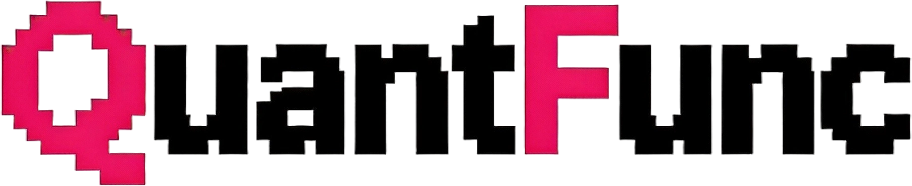

<div align="center" style="margin-top: 50px;">
  
</div>

<p align="center">
  🌐 <a href="https://www.quantfunc.com/">Website</a> &nbsp;|&nbsp;
  🤗 <a href="https://huggingface.co/QuantFunc">Hugging Face</a> &nbsp;|&nbsp;
  🤖 <a href="https://www.modelscope.cn/profile/QuantFunc">ModelScope</a> &nbsp;|&nbsp;
  💬 <a href="#wechat">WeChat (微信)</a> &nbsp;|&nbsp;
  🎮 <a href="https://discord.gg/jCp9TpFWcn">Discord</a>
</p>

# ComfyUI-QuantFunc

## 1. Introduction

ComfyUI plugin for **QuantFunc** — the fastest diffusion model inference engine. Run quantized text-to-image and image editing models at 2x–11x speed with zero Python model dependencies.

**Key features:**
- Native C++/CUDA acceleration via `libquantfunc.so` / `quantfunc.dll`
- QuantFunc loaders for MiniMax-H3, LTX-2.5, Krea-2 and Qwen-Image-2.1 that work with ComfyUI's own text encoder, VAE and
  sampler nodes
- Changing quality_enhance, attention, caches or LoRAs reuses the loaded model: only a different model file, or the
  pinned_memory switch, loads it again
- Image editing with reference images (Qwen-Image-2.1)
- The engine installs itself on Linux and Windows, checked against the release's published SHA-256 manifest

## Quick Start

1. Clone into your ComfyUI custom nodes folder:

   ```bash
   cd ComfyUI/custom_nodes
   git clone https://github.com/QuantFunc/ComfyUI-QuantFunc.git
   ```

2. Restart ComfyUI. The plugin installs the compatible engine for your system, CUDA version and GPU architecture.
3. Install the required models and import an [example workflow](example_workflows/). For image-conditioned examples, copy the [included reference images](example_workflows/assets/README.md) into `ComfyUI/input`.

**Requirements:** NVIDIA GPU, Linux or Windows, and a compatible CUDA 12/13 environment. See the [installation and usage guide](docs/USER_GUIDE.md) for supported GPUs, dependencies, manual installation and troubleshooting.

## MiniMax-H3 Workflows

<table>
  <tr>
    <td align="center"><br><strong>First / last frame</strong></td>
    <td align="center"><br><strong>Reference image</strong></td>
  </tr>
</table>

Reference images included with the example workflows.

| Workflow | Use |
|---|---|
| [FL2VA](example_workflows/QuantFunc-MiniMaxH3-fl2va.json) | First/last-frame video with audio |
| [FL2VA · double sampling](example_workflows/QuantFunc-MiniMaxH3-fl2va-double-sampling.json) | Two-stage generation and latent upscale; image inputs are bypassed by default |
| [Ref2VA](example_workflows/QuantFunc-MiniMaxH3-ref2va.json) | Reference-image video with audio |
| [Ref2VA · double sampling](example_workflows/QuantFunc-MiniMaxH3-ref2va-double-sampling.json) | Reference-image generation with two-stage sampling and latent upscale |

[All example workflows →](example_workflows/)

## Recent Updates

### Engine 0.0.18 · Plugin 0.0.08

- **4×–43× smaller runtime engine download (~100–200+ MB → 4–28 MB):** refactored to a standalone single-Transformer PC Engine with a zero-CUDA host library (`libquantfunc.so` / `quantfunc.dll`) and single-architecture CUDA 12/13 kernel plugins (`sm75`, `sm86`, `sm89`, `sm120a`). Per-GPU runtime downloads drop from **129–174 MiB** on Linux / **95–146 MiB** on Windows in `0.0.17` (**164–288 MiB** incl. CLI binary) down to **4.0–5.5 MiB** on Linux and **14.0–17.6 MiB** on Windows for RTX 40/50 series (`sm89`/`sm120a`; **21.8–28.3 MiB** for `sm75`/`sm86`).
- **Dramatically faster startup & model loading:** eliminated legacy pipeline overhead and multi-pass weight repacking (`0.0.17` progressive MiniMax-H3 load took **13.3–23.5 s** on RTX 3090). In `0.0.18`, cold engine init takes **~0.19 s**, full NVMe model loads drop to **0.54–0.88 s** (Qwen-Image-2.1), **1.14 s** (Krea-2), **1.30 s** (MiniMax-H3) and **1.07–1.49 s** (LTX-2.5 15.8 GB / 18,561 tensors — **2.18× faster** than ComfyUI's native loader at 3.26 s, with 84 ms cold / 8.4 ms cached header parsing), and LoRA hot-swap runs in **1.8 ms** without reloading.
- **Built-in attention & linear speedup vs ComfyUI-Kitchen / PyTorch SDPA (with accuracy metrics):**
  - **4-bit linear layers vs ComfyUI-Kitchen (`int8_convrot`, 20 real layers):** median **1.56×** faster on Blackwell `SM120` (up to `1.85×`), **1.44×** on Turing `SM75` (up to `1.87×`), **1.22×** on Ampere `SM86` (up to `1.44×`), and **1.15×** on Ada `SM89` (up to `2.22×`).
  - **Built-in attention tiers (`auto`, `int8`, `i4xi8`, `int4`, `fp16` — 13 real shapes × 3 precision tiers):** vs PyTorch SDPA (BF16/FP16), median **1.61×–3.36×** (`int8`), **1.88×–4.07×** (`i4xi8`), and **2.44×–5.31×** (`int4`, up to **6.75×** on SM75; up to **1077 TFLOPS** on SM120 / **865 TFLOPS** on SM89); also **1.13×–2.40×** median faster than prior quantized attention baselines.
  - **Accuracy vs FP32/FP16 reference:** `int8` cosine similarity **0.9989–0.9999** (4K normal `0.9990–0.9999`, H3 50× outlier `rel_l2 = 0.0002`, virtually lossless), `i4xi8` **0.9878–0.9990** (4K normal `0.9977–0.9990`), and `int4` **0.9506–0.9900** (SM120 `0.9862–0.9900`).
- **Blackwell (SM120) quality & 8 GB VRAM stability:** upgraded SM120 low-rank sidecars to native INT8 Tensor Core + BF16 residual accumulation, eliminating diagonal blur artifacts on RTX 50-series MiniMax-H3 (1:1 visual parity with RTX 4090 SM89; 1.6% faster across the full 4-model RTX 5060 Ti suite vs the pre-fix SM120 build) with 0 OOM across 8 GB cards.
- **Bug fixes & workflow updates:** added full **LTX-2.5 audio reference (`ref_audio`)** and **video/audio per-frame `denoise_mask`** (`frame_t_scales` / `audio_frame_t_scales`) support with clean session reset; fixed `QF:PL_PERM`, clone 2× VRAM inflation, cold autoload, Windows locked-DLL updates, MiniMax-H3 3D audio packing, and Qwen-Image-2.1 `CFG=1.0` & RGBA transparent alpha; unified all 12 example workflows to `res_multistep` with `sol_min_tokens=0` on LTX-2.5 and MiniMax-H3.

### Engine 0.0.17 · Plugin 0.0.07

- **Built-in attention backends:** architecture-matched attention backends (`auto`, `int8`, `i4xi8`, `int4`, `fp16`) for Linux and Windows.
- **SM75 performance:** faster inference on Turing GPUs.
- **VRAM management:** more efficient memory use and model movement for faster inference.
- **MiniMax-H3 workflows:** updated single- and double-sampling examples for better image quality and speed.

### Engine 0.0.13 · Plugin 0.0.07

- Added quality-enhancement and pinned-memory controls.
- Reuse loaded models when changing settings or LoRAs.
- Architecture-specific engines, simpler LoRA handling and quieter logging.

## Community

[Discord](https://discord.gg/jCp9TpFWcn) · [Website](https://www.quantfunc.com/) · [License](https://www.modelscope.cn/models/QuantFunc/Plugin)

<div align="center" id="wechat">
  
</div>
